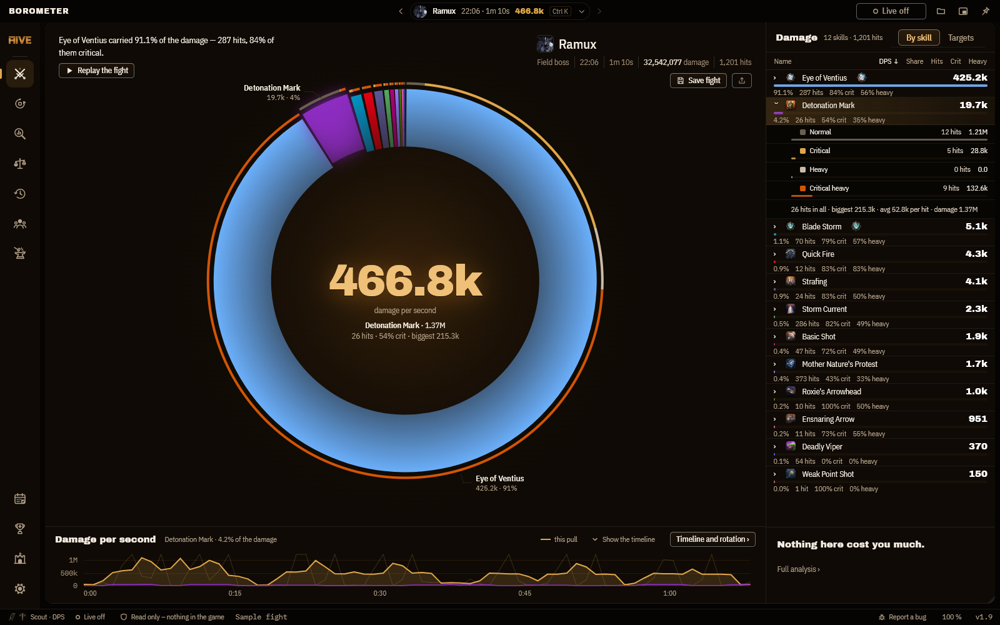
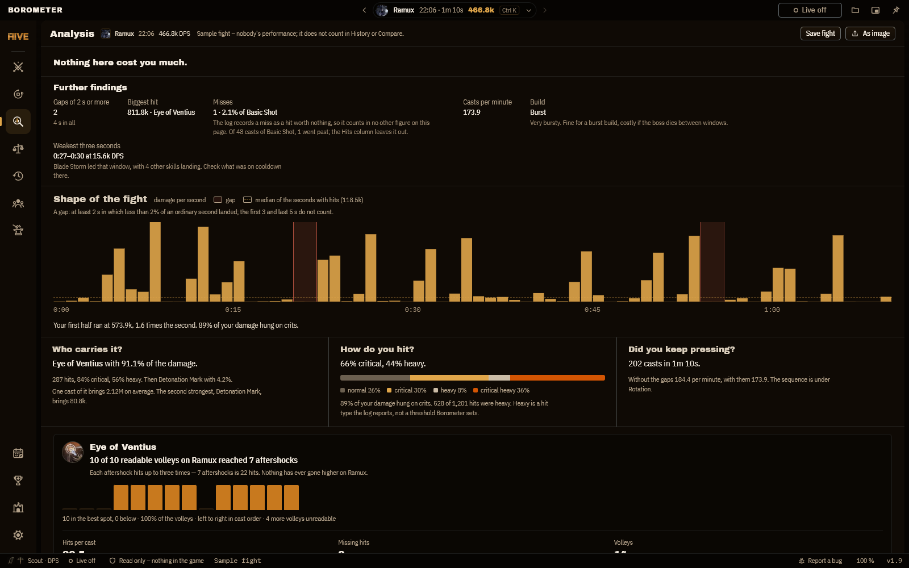
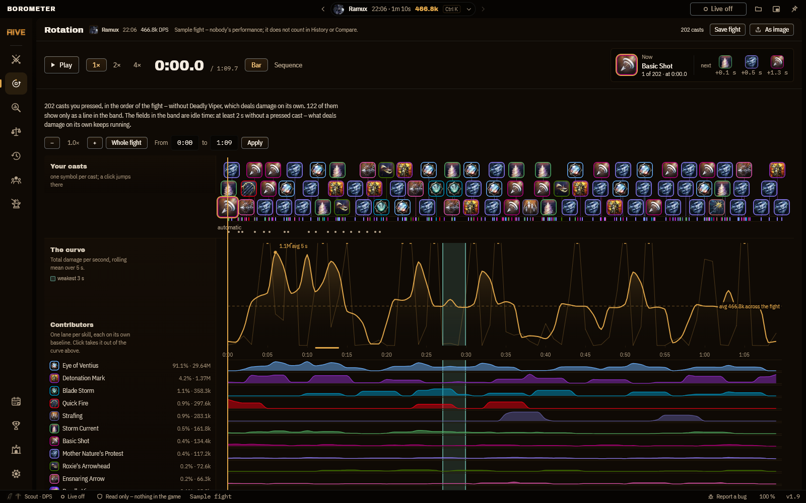
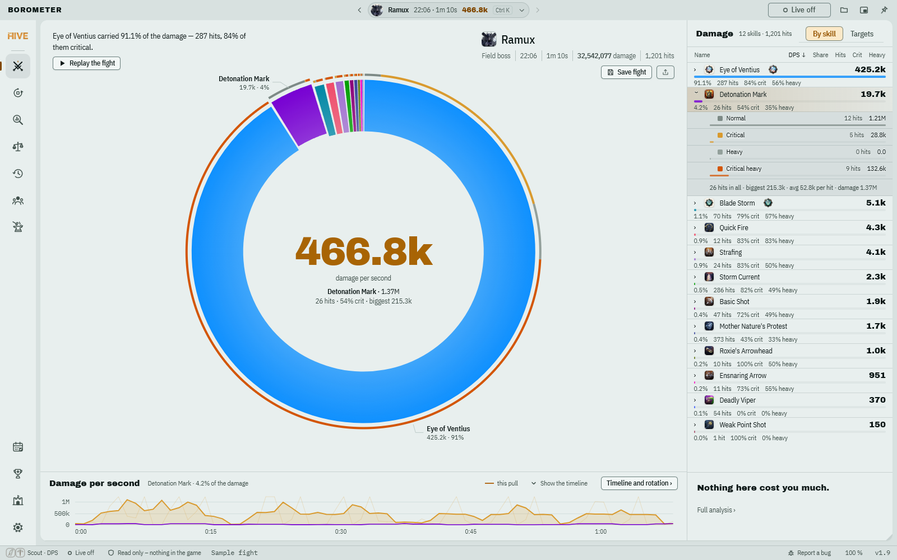
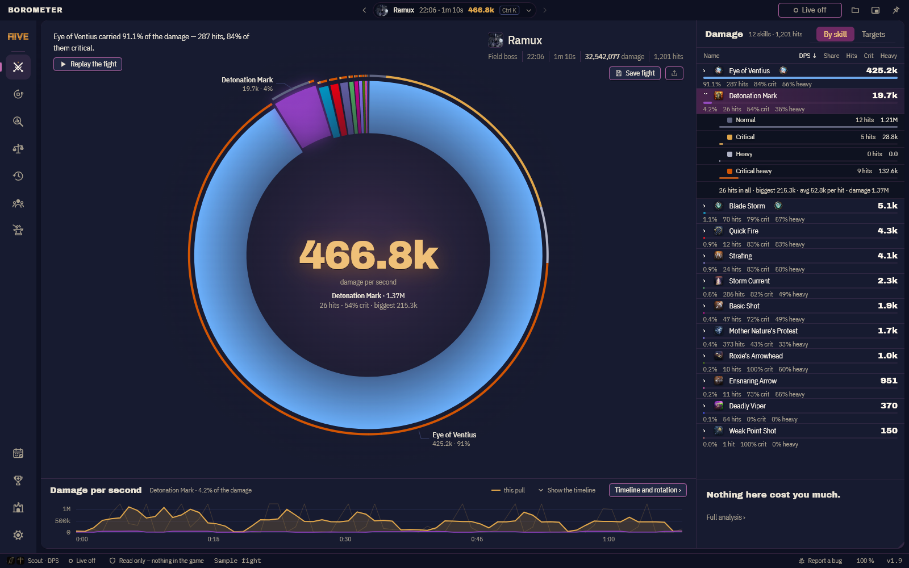
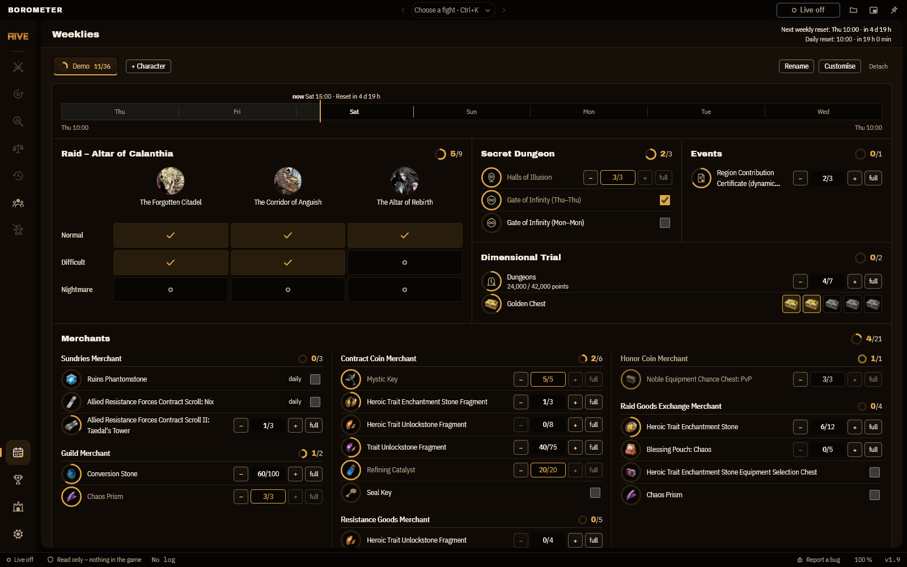
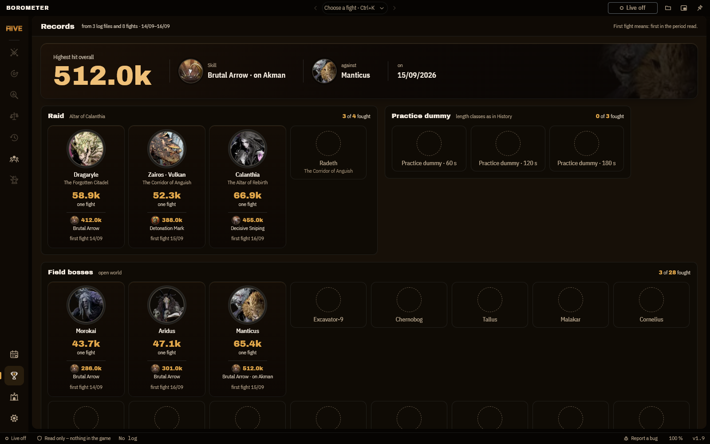

# Borometer

**Ich wollte wissen, was ich nach einem Pull ändern soll, ohne etwas ins Spiel
zu hängen.** Darum liest Borometer nur die Kampflog-Datei, die **Throne and
Liberty** selbst schreibt, und sagt dir in Sätzen, was deinen Schaden getragen
hat und wo Sekunden fehlten. Dazu zeigt es dir den Verlauf gegen deinen besten
Pull. Kein Eingriff ins Spiel, kein Konto, keine Werbung, kein Geld. Es läuft
auch ohne Internet, und der Quelltext ist offen.

Es sendet keine Telemetrie und ruft von sich aus nichts im Netz auf. Gruppe,
Gilde online und der Update-Hinweis laufen nur, wenn du sie selbst einschaltest.

Hallo ihr Lümmel da draussen! Die App ist vollständig KI generiert. Das einzige was ich gemacht habe ist ihm lediglich zu sagen was er basteln soll und fixxen soll. Denn KI ist genauso blöd wie der Nutzer.
Viel Spaß damit. :-)

> **Fanprojekt.** Nicht verbunden mit NCSOFT oder Amazon Games (not affiliated with
> NCSOFT or Amazon Games), von ihnen weder unterstützt noch geprüft. Throne and Liberty
> ist eine Marke von NCSOFT. Borometer ist kostenlos, ohne Werbung und ohne Spenden
> (free, no ads, no donations). Spielbilder gehören ihrem Eigentümer und fallen nicht
> unter die GPL. Die Release-Downloads betten sie ein, der Quelltext enthält keine,
> und die Bildschirmfotos auf dieser Seite zeigen einen Release-Build.

**[Neueste Version herunterladen](https://github.com/B0R0AK/Borometer/releases/latest)**
als Installer oder als portable Exe, die ohne Installation überall läuft.

*[English version: README.md](README.md)*

Der ausgewählte Kampf steht als Ring da, als Glutring. Jeder Bogen ist eine
Fähigkeit, so groß wie ihr Schaden, und in der Mitte steht die große Zahl. Über
dem Ring stehen die Fakten des Kampfs und **ein Satz, der ihn liest**: welche
Fähigkeit ihn getragen hat, ob das Ziel zwischendurch gar nicht zu treffen war,
oder dass es für eine Aussage zu wenige Treffer waren. Bekannte Bosse tragen ihr
Porträt neben dem Namen.

Rechts neben dem Ring stehen die Fähigkeiten nach Schaden sortiert, mit Anteil,
Treffern und den Quoten für kritisch und stark. Ein Klick auf einen Bogen klappt
diese Fähigkeit in der Liste mit ihren Trefferarten auf. In der Gruppe zeigt der Ring die Mitglieder.
**Kampf nachspielen** lässt die Fähigkeiten als Rennen gegeneinander laufen; ihre
Balken wachsen mit dem Schaden bis zu diesem Moment.

Die Kämpfe selbst stehen in der Kampfwahl in der Mitte der Titelleiste
(Strg + K), zu Dungeon-Läufen gruppiert und nach ihrem Boss benannt.

> Der [Feature-Guide](GUIDE.md) erklärt alles der Reihe nach: jeden Reiter, jeden
> Knopf, die Tastenkürzel und die Rechenwege dahinter.

*(Die Bildschirmfotos zeigen die App auf Englisch. Jede Beschriftung gibt es auch
auf Deutsch. Die Sprache stellst du im Menü „Mehr“ (···) oben in der Leiste um
oder unter Einstellungen › Sprache.)*

---

## Jede Zeile klappt auf

Ein Klick auf eine Fähigkeit zeigt, wie ihr Schaden zustande kam. Normal,
kritisch, stark und kritisch stark bekommen je einen eigenen Balken, ihre
Trefferzahl und ihren Schaden, darunter stehen Treffer gesamt, der größte
Treffer und der Schnitt je Treffer. In Kompakt zeigen die Trefferarten
zusätzlich ihren Anteil am Schaden der Fähigkeit, und die starken tragen ein
`×2`, weil ein starker Treffer doppelten Schaden anrichtet.

## Was der Kampf verrät

Die Analyse sagt in Sätzen, was in den Zahlen steht: wie stoßweise der Schaden
lief, wo die schwächsten drei Sekunden lagen, wie viel Leerzeit dazwischen
stand, wie viele Angriffe danebengingen, und bei Auge von Ventius, wie viele
deiner Salven so viele Nachbeben getragen haben wie deine beste. Wie viele
Nachbeben ein Ziel überhaupt hergibt, hängt an seiner Größe; deshalb steht die
Obergrenze je Boss in einer Tabelle, statt festgeschrieben zu sein.

Unter den Sätzen läuft der Kampf als ein Streifen über die ganze Breite, mit
einem Fach je Fähigkeit, so groß wie ihr Gewicht. Die Befunde hängen als Fahnen
über dem Streifen: jede Lücke, die schwächste Stelle, der Start, die stärksten
fünf Sekunden. Drückst du eine Fahne, erscheint ihr Satz, und die Fächer, die
dort nichts beigetragen haben, treten zurück. Jeder Einsatz ist ein Strich in
einer von vier Hitzestufen (normal, stark, kritisch, kritisch stark), dein
bester Pull läuft als gestrichelte Kurve mit, und jede Zeile sagt in einem Satz,
was an ihrer Fähigkeit auffällt: eine Pause im eigenen Takt, weniger Einsätze
als im besten Pull oder nur Zahl und Takt. Die Quote für kritisch und stark
zählt nur direkte Treffer, ohne Laufzeit und Passiv, und die Seite nennt, wie
viele Treffer das waren.

## Wann du was eingesetzt hast

Ein Symbol je Einsatz, eine Spur je Fähigkeit. Lücken in der Rotation sieht man
hier schneller als in jeder Tabelle. Strg + Scrollen zoomt hinein, die Leiste
zieht den Ausschnitt, und mit der Tastatur geht es genauso.

## Zwei Kämpfe nebeneinander

Hake zwei bis vier Kämpfe an, aus dem geladenen Log oder aus dem, was du
gespeichert hast. Borometer sagt, wer gewinnt und woher der Unterschied kommt
(meist tragen zwei oder drei Fähigkeiten fast alles davon), und stellt die
Kennzahlen direkt gegenüber. Sind die Kämpfe verschieden lang, sagt es das und
bietet an, beide auf den kürzeren zu kürzen. Ohne das vergleicht man Summen,
die nur deshalb größer sind, weil länger gekämpft wurde.

## Vier Themen

Dunkel, hell, ein drittes in den Farben des Spiels und Rauchglas, das unter
Windows 11 verwischt durchscheinen lässt, was hinter dem Fenster liegt. Der
Kontrast ist bei allen vieren durchgemessen. Borometer übernimmt die
Einstellung von Windows, oder du wählst sie fest. Alle Fenster nutzen dieselben
zwei Schriften: Anton für Titel und Zahlen, Source Sans 3 für Text, Namen, Pfade
und Zeiten. Beide sind frei (SIL Open Font License) und eingebaut, es wird also
nichts aus dem Internet nachgeladen.

## Weeklies

Ein Reiter je Charakter: der Raid als Raster aus Flügeln und Schwierigkeiten,
das Geheimdungeon, Events, die Dimensionsprüfung und die Händler, jeweils mit
Zähler. Ein Band zeigt, wo die Woche steht und wann der nächste Wochen- und
Tages-Reset kommt. Nichts davon wird aus dem Spiel gelesen; du hakst es selbst
ab. Ein Charakter, den du als Main markiert hast, steht vorn und öffnet zuerst.

## Rekorde

Borometer liest deine Logs einmal und führt ein Album: je Boss dein bester
DPS, dein stärkster Treffer mit der Fähigkeit, die ihn traf, und der Tag
deines ersten Kampfes. Bosse, gegen die du noch nicht gekämpft hast, stehen
als leere Umrisse da.

## Mehrere Charaktere

In den Einstellungen unter Charaktere stehen die Charaktere aus den Weeklies,
und zu jedem trägst du den Lognamen ein, den Angreifernamen genau so, wie das
Log ihn schreibt. Einen davon kannst du als Main markieren. Borometer weiß dann,
welcher Charakter welchen Kampf bestritten hat, und die Rekorde sagen, wer
welchen hält: eine Leiste über dem Album zählt sie als Gesamt, Main, Twinks und,
wo Kämpfe keinen bekannten Charakter haben, Unbekannt. Der Verlauf merkt sich
nur eine Kennung des Charakters, nie den Namen. Ohne Lognamen bleiben die
Rekorde, wie sie waren.

## Archiv der Bosskämpfe

Borometer legt von jedem Bosskampf, den es liest, eine Kopie im Ordner `archiv`
neben den Einstellungen ab, nur auf deinem PC. Dazu zählen Feldbosse,
Raidbosse, Dungeons, die Halle der Illusionen und die Übungspuppe; Trash und
Gruppensummen nicht. Löscht das Spiel später seine Logs, bleiben die Kopien. Beim
ersten Mal sagt ein Hinweis auf der Startseite, was das Archiv tut, und vor
deiner Bestätigung wird nichts aufgenommen. Einstellungen › Archiv schaltet es
aus, öffnet den Ordner, und **Alte Logs einlesen** nimmt die Kämpfe aus den Logs,
die noch im Ordner des Spiels liegen, ins Archiv auf.

Der Bereich *Archiv* in der linken Leiste listet jeden bekannten Boss als Karte
mit bestem DPS und Zahl der Kämpfe, gegliedert wie die Rekorde und durchsuchbar
nach deutschem und englischem Namen. Ein Klick öffnet den Boss: die Punkte aller
seiner Kämpfe über die Zeit, den Median, den besten markiert, und darunter die
Kämpfe selbst, neueste zuerst. Ein Kampf öffnet sich aus dem Archiv, auch wenn
sein Log nicht mehr da ist, und **Log öffnen** in den Rekorden tut dasselbe.

Kämpfe, die du nicht mehr willst, lassen sich lösen, einzeln oder mehrere, mit
Rückgängig. Endgültig löschen kannst du sie nur aus der Liste der gelösten
Kämpfe: Du tippst Boss und Datum ein (bei mehreren deren Anzahl), und Borometer
legt vorher die Kampfdateien und das Verzeichnis im Ordner `sicherungen` ab und
prüft die Kopie. Ist sie unvollständig, wird nichts gelöscht. Die Sicherung
löscht Borometer nie, und von sich aus löscht es nichts.

## Gilde

Für Gildenleitungen: eine Mitgliederliste mit Waffen und Rolle, Termine, die
sich wiederholen, Anwesenheit je Termin (da, nicht da, entschuldigt) und eine
Übersicht mit Quote und Serie, ohne Farben und ohne Ränge. Ein Reiter Punkte,
ab Werk aus, führt je Mitglied ein Konto aus aktiven Monaten, Bossen und Raids,
Ansehen in der Gilde und Zusatzpunkten von Hand; die Regeln lassen sich ändern.
Solange du nichts anderes einstellst, liegt die Gilde in `boro-gilde.json` auf
deinem PC, und nichts wird gesendet.

Eine Gildenleitung kann **Gilde online** einschalten. Die Liste liegt dann auf
einem Server unter einer `https://`-Adresse, die die Leitung selbst einträgt,
und Mitglieder treten mit Code oder Link bei und sehen die Liste, ohne sie ändern
zu können. Der Betreiber dieses Servers kann alles lesen, was dort liegt; das
sagt die Einrichtung, bevor die Gilde angelegt wird. Eine Gilde, die niemand
mehr braucht, wird gelöst, nicht gelöscht. Aus der Liste der gelösten Gilden,
Mitglieder und Arten kannst du sie endgültig löschen, nachdem du den Namen
getippt hast und Borometer eine Sicherungsdatei in `sicherungen` angelegt hat.

## Kompakt

Für den zweiten Monitor oder über das Spiel gelegt: ein flaches Panel mit
Ablesewert und Balken, mehr nicht. Links steht die große DPS-Zahl, darunter der
Vergleich zum letzten Pull, rechts Boss, Uhrzeit und Dauer. Eine Kante links
steht voll, solange Live läuft. Zwei Reiter, *Kampf* und *Weeklies*, wechseln
die Ansicht (Strg+Umschalt+W auch). Die Fähigkeiten zeigen fünf Zeilen und
rollen mit dem Mausrad; der Knopf darunter öffnet die ganze Liste, und das
Fenster wächst mit. Anfassen lässt sich das Fenster an der ganzen Kopfzeile.
Kleiner als die Leiste und die erste Zeile lässt es sich nicht ziehen. Das
Fenster lässt sich durchsichtig stellen, in ganzen Schritten von 0 bis 55 %, und
über allen anderen halten. **Esc** führt zurück.

## Windows

Rechtsklick, Umschalt+F10 oder die Menütaste auf einer Zeile der Schadenstafel
öffnet das Windows-Menü am Mauszeiger, auf Deutsch oder Englisch, je nach
Spracheinstellung. *Kopieren* legt Fähigkeit und Wert in die Zwischenablage
(Strg+C auf der fokussierten Zeile tut dasselbe), *In Rotation zeigen* springt in
die Rotation und hebt die Fähigkeit hervor. Im Kopf von Kampf, Rotation, Analyse
und Vergleich legt ein Knopf den Bereich in ein eigenes Fenster, zum Beispiel
für den zweiten Monitor. Es gibt höchstens ein solches Fenster; es folgt dem
Kampf der Vollansicht, schreibt nichts und schließt mit ihr. Im Kompaktfenster
und im Browser gibt es weder Menü noch Knopf.

Mehr von Windows steht in den Einstellungen unter Windows, alles ab Werk aus bis
auf das Tray-Symbol: ein Hinweis nach jedem Kampf (auch nur bei einem neuen
Bestwert), eine Sprungliste am Taskleistensymbol mit den zuletzt gelesenen Logs,
ein Fortschrittsbalken beim Laden eines großen Logs und der Start mit Windows.

---

## Loslegen

### 1. Kampflog im Spiel einschalten

    Einstellungen → Tastenkürzel → Ringmenü → "Kampfmesser" hinzufügen

Danach einmal im Ringmenü aktivieren. Ab dann schreibt das Spiel bei jedem
Kampfende eine Datei.

### 2. Borometer holen

**Fertig herunterladen.** Unter
[Releases](https://github.com/B0R0AK/Borometer/releases/latest) hängen an
jeder Version drei Dateien. Es ist dieselbe App, nur anders verpackt:

| Datei | Was es ist |
|---|---|
| `Borometer-Setup-<Version>.exe` | **Installer.** Legt Startmenü- und Desktop-Verknüpfung an, lässt sich über die Windows-Einstellungen wieder deinstallieren. Gespeicherte Kämpfe landen unter `Dokumente\Borometer`. |
| `Borometer-<Version>-portable.exe` | **Portabel, eine Datei.** Nichts installieren, einfach starten, auch vom USB-Stick. Gespeichertes landet neben der Exe. |
| `Borometer-<Version>-win-x64.zip` | **Portabel, als Ordner.** Wie oben, nur ausgepackt: entpacken, `Borometer.exe` starten. Siehe unten, warum es die gibt. |

Die Einstellungen teilen sich alle drei (siehe unten), du kannst also jederzeit
wechseln, auch von einer älteren Python-Fassung.

**Oder selbst bauen**, wenn du lieber dem Quelltext traust als einer fertigen
Datei:

1. [Node.js](https://nodejs.org/) ab Version 22 installieren.
2. Im Ordner des Quelltexts `npm ci` ausführen. Das holt Electron, TypeScript
   und die Build-Werkzeuge.
3. `npm run dist:win` baut alle drei Dateien nach `release\`. Nur ausprobieren
   ohne zu verpacken: `npm start`.

Ein eigener Build zeigt Borometers gezeichnete Marken, wo die Downloads
Spielbilder zeigen ([Aus dem Quelltext bauen](#aus-dem-quelltext-bauen)).

### 3. Starten

Den Log-Ordner unter `%LOCALAPPDATA%\TL\Saved\CombatLogs` findet Borometer von
selbst. Mit dem Beobachten fängt es aber erst an, wenn du oben auf
**Live aus** drückst (auf der Startseite: **Live-Aufzeichnung starten**). Dann
steht dort **Live**, und ein zweiter Klick beendet es. Von allein lädt es nie
etwas, auch keinen Kampf, der schon im Ordner liegt. Ab dem Klick schaut es
alle zwei Sekunden nach einer neueren Datei, ein Pull erscheint also kurz nach
dem Kampf: das Spiel schreibt das Log erst beim Kampfende, nicht währenddessen.

Findet Borometer den Ordner nicht von selbst, sagt es das auf der Startseite
und bietet **Ordner wählen** an. Einmal aussuchen, danach ist er gemerkt.

Ohne Exe geht es auch: `npm start` im Quelltext, oder die gebaute
`boro-meter.html` (hängt ebenfalls am Release) einfach im Browser öffnen. Dort
funktioniert alles bis auf das automatische Beobachten. Im Browser zieht man
die Log-Datei hinein oder klickt **Live aus** und wählt den Log-Ordner, was
Chrome oder Edge voraussetzt.

### Beim ersten Start

Seit 2.0.0 sind die Windows-Dateien mit einem Code-Signing-Zertifikat von
Certum signiert und mit einem Zeitstempel versehen: der Installer, die portable
Exe sowie die Exe und die Electron-eigenen DLLs in der Zip-Datei. Die Zip-Datei
selbst ist nicht signiert, und zwei DLLs (`d3dcompiler_47.dll`, `dxil.dll`)
tragen weiter die Signatur von Microsoft. Als Herausgeber steht im Zertifikat „Open Source Developer“, gefolgt
vom Namen des Maintainers.

SmartScreen kann trotzdem „Der Computer wurde durch Windows geschützt /
Unbekannte App“ zeigen. SmartScreen urteilt nach Ruf, und eine Datei, die
Microsoft noch nicht kennt, hat noch keinen. Er wächst mit der Zahl der
Downloads und braucht Tage bis Wochen. Der Hinweis nennt den Herausgeber, und er
heißt nicht, dass die Datei kaputt ist: Die Signatur zeigt, von wem sie kommt.
Zum Fortfahren wähle **Weitere Informationen → Trotzdem ausführen**.

Möglicherweise schlägt auch dein Virenscanner an, am ehesten bei der portablen
Einzeldatei. Sie entpackt sich bei jedem Start in einen temporären Ordner, und
diese Selbstentpackung lesen manche Scanner als verdächtig. Es ist ein
Fehlalarm, aber wenn es stört, nimm den Installer oder die Zip-Datei. Beide
entpacken beim Start nichts, und die Heuristiken springen darauf deutlich
seltener an. Ist dir eine fertige Datei trotzdem nicht geheuer, bau sie selbst
aus demselben Quelltext.

Meldet ein Scanner eine der Dateien, ist der richtige Weg eine
Fehlalarm-Meldung an den Hersteller (Microsofts Formular:
[microsoft.com/wdsi/filesubmission](https://www.microsoft.com/en-us/wdsi/filesubmission)),
nicht das Abschalten des Virenscanners.

---

## Gruppen-Board

Jeder schickt seinen neuesten Kampf, und alle sehen ein gemeinsames, sortiertes
Board mit Klasse und Rolle neben jedem Namen, etwa Orakel · Heiler oder
Kreuzritter · Tank. Die Zeilen lassen sich aufklappen. Alles dafür steht im
Reiter *Gruppe*.

**Wenn im Clan schon ein Server läuft**, was der häufigste Fall ist, trägst du
nur einmal seine Adresse ein: unter *Gruppen-Server* ins Feld **Server-Adresse**,
dann **Speichern**. Danach reicht der Vier-Zeichen-Code, den jemand herumgibt.
Bleibt das Feld leer, hostet Borometer stattdessen über deinen eigenen PC.
Hat dein Clan keinen Server, steht allen der [Gästeserver](#gästeserver) weiter
unten offen.

**Vom eigenen PC gehostet.** Charakternamen eintippen und **Gruppe hosten**
drücken. Du bekommst einen Code aus vier Zeichen samt Adresse, etwa
`AB7K@192.168.1.20:8732`. Der Code besteht aus Buchstaben und Ziffern, aber ohne
0, O, 1 und I, damit sich beim Vorlesen nichts verwechselt. Alle anderen tippen
ihren Namen ein, fügen die ganze Zeichenkette ein und drücken **Mit diesem Code
beitreten**. Für alle im selben Netz wie der Host läuft das ohne Weiteres. Übers
Internet muss der Host erreichbar sein, also entweder über einen
weitergeleiteten Port oder über etwas wie Tailscale, das euch auf ein virtuelles
Netz legt.

Während des Hostens öffnet Borometer einen zweiten Port, der ausschließlich
Gruppenverkehr beantwortet. Logs oder Einstellungen sind darüber nicht
erreichbar, und jede Anfrage ohne den aktuellen Code wird abgewiesen. Gruppe
schließen schließt den Port.

**Einen eigenen kleinen Server aufsetzen.** Dann hängt die Gruppe nicht mehr
daran, dass der PC eines bestimmten Spielers an und erreichbar bleibt. Der Server
liegt in [`BoroPartyServer/`](BoroPartyServer/): eine einzige Python-Datei
ohne Fremdpakete, dazu eine systemd-Unit und die Einrichtungsanleitung
[`SELF-HOSTING.md`](BoroPartyServer/SELF-HOSTING.md) (englisch). Er
behält nur, was die Borometer ihm schicken, und nur im Arbeitsspeicher: je
Spieler Charaktername und die zwei Waffen; zu seinem neuesten Kampf Ziel,
Startzeit und Dauer, Schaden, DPS, Treffer, die Werte für kritisch und stark
und den größten Treffer; dazu für bis zu zwölf Fähigkeiten ihre Namen mit
denselben Werten, aufgeteilt nach Trefferart, eine Schadenskurve je Sekunde und
die Zeiten ihrer Einsätze. Er liest nie ein Kampflog und redet mit nichts außer
den Borometern, die ihm etwas schicken.

Die Gruppe schreibt nichts auf die Platte und bewahrt nichts auf: Ein Raum
verschwindet 30 Minuten, nachdem das letzte Mitglied gegangen ist, und ein
Server, der für alle gedacht ist (mit `BORO_ROOM_MAX_AGE`), verwirft jeden Raum
spätestens nach 12 Stunden. (Der Gilde-Speicher, ein eigener Teil desselben
Servers, legt seine Dateien dagegen auf der Platte ab.) Es gibt keine
Konten und keine Telemetrie. Ein Server für Fremde setzt Grenzen für Räume,
Namen und Anfragen; sie stehen in
[`SELF-HOSTING.md`](BoroPartyServer/SELF-HOSTING.md) (englisch).

---

## Gästeserver

Hat dein Clan keinen Server, kannst du den nutzen, den das Projekt betreibt:
`https://guest.borometer.de`. Er steht allen offen, zum Ausprobieren des
Gruppen-Boards und zum Benutzen. Ist zu viel los, kann er deaktiviert werden. Die
Adresse antwortet dann mit einem kurzen Hinweis, und Borometer zeigt, dass nichts
antwortet. Dass er immer läuft, ist nicht zugesagt; eine Gruppe, auf die es
ankommt, gehört auf einen eigenen Server oder den PC des Hosts.

**So nutzt du ihn.** Im Reiter *Gruppe* wählst du unter *Wo die Gruppe läuft*
den *Öffentlichen Server*. Adresse und ein Hinweis erscheinen, und **Diesen
Server verwenden** speichert die Adresse. Erst dieser Klick speichert sie; davor
fragt Borometer nichts an. Du kannst `https://guest.borometer.de` auch selbst
unter *Gruppen-Server* ins Feld **Server-Adresse** eintragen und **Speichern**
drücken. Danach gilt der Vier-Zeichen-Code wie bei jedem Gruppen-Server. Trägst
du die Adresse nie ein, geht nichts dorthin.

**Was er ist.** Dieselbe Datei wie der Gruppen-Server in
[`BoroPartyServer/`](BoroPartyServer/), gestartet mit den Grenzen für Fremde und
ohne Gilde-Speicher. Er schreibt nichts auf die Platte. Ein Raum ist 30 Minuten
nach dem Weggang des letzten Mitglieds weg, spätestens nach 12 Stunden oder wenn
der Server neu startet. Es gibt keine Konten und keine Telemetrie. Er kennt, was
jeder Gruppen-Server kennt (beschrieben unter *Gruppen-Board*), und nicht mehr.

**Grenzen.** Höchstens 500 Räume gleichzeitig, 3000 Namen in allen Räumen
zusammen und 40 Namen in einem Raum. Ein Absender darf 180 Anfragen in der Minute
stellen und 10 neue Räume in der Stunde anlegen. Zwanzig verschiedene falsche
Codes in einer Minute lösen eine Pause von fünf Minuten aus; Codes zu raten führt
also zu nichts. Ist der Server voll, wird ein neuer Raum mit einem kurzen Hinweis
abgelehnt. Die Zähler liegen im Arbeitsspeicher und verfallen nach ihrem
Zeitfenster. Die Werte stehen in der Dienstdatei
[`boro-party-public.service`](BoroPartyServer/boro-party-public.service) und
sind in [`SELF-HOSTING.md`](BoroPartyServer/SELF-HOSTING.md) (englisch)
erklärt.

---

## Was hier liegt

| Datei | Wofür |
|---|---|
| `src/renderer/` | die Oberfläche: `index.html`, `styles.css`, `types.ts`, `main.ts` und in `app/` das Seitenskript als nummerierte ES-Module (Parser, Meter, Diagramme, Vergleich, Gruppe) |
| `src/main/` | das Hauptprogramm in TypeScript: Fenster, Log-Ordner, Speichern, Gruppe |
| `scripts/build-renderer.mjs` | bündelt die Oberfläche mit esbuild zu einer einzigen HTML-Datei |
| `src/renderer/spielbilder.ts` | die Tabellen der Spielbilder, in diesem Quelltext leer; der Release-Build füllt sie |
| `scripts/safety-audit.mjs` | prüft mechanisch, dass die App nur liest ([was es prüft](#was-das-audit-prüft)) |
| `scripts/audit-negative.mjs` | bricht jede Regel des Audits absichtlich und prüft, dass das Audit es merkt |
| `electron-builder.yml` | wie Installer, portable Exe und Zip gepackt werden |
| `build/` | Programmsymbol, dazu Bilder und Texte des Installers (`installer.nsh`; die Bilder zeichnet `npm run installer-art`) |
| `CHANGELOG.de.txt` / `CHANGELOG.txt` | was sich je Version geändert hat |
| `BoroPartyServer/` | der optionale Gruppen-Server, mit [Anleitung zum Selbst-Hosten](BoroPartyServer/SELF-HOSTING.md) |
| `SECURITY.md` | wie man eine Sicherheitslücke vertraulich meldet |
| `CONTRIBUTING.md` | wie man helfen kann: nur über Issues |

Das Arbeits-Repository prüft zusätzlich mit einem Bildschirm-Paritätstest gegen
einen festen Bezug; der braucht den privaten Verlauf und gehört nicht zu diesem
Repository.

Die Einstellungen liegen unter `%APPDATA%\Borometer\boro-config.json`, für
Installer, portable Exe und Zip dieselbe Datei. Eine ältere Datei neben der Exe
wird beim ersten Start einmal übernommen, für ein Update genügt es also, die
neue Version zu starten.

Was Borometer selbst schreibt (`Logs`, `Party-Logs` und `Bug-Reports`),
entsteht erst, wenn du zum ersten Mal so eine Datei speicherst: bei der
installierten Fassung unter `Dokumente\Borometer`, bei den portablen neben der
Exe. Das Archiv der Bosskämpfe (`archiv`) und die Sicherungen, die vor jedem
endgültigen Löschen entstehen (`sicherungen`), liegen neben der Einstellungsdatei.

---

## Wenn etwas nicht stimmt

Links in der Leiste steht **Fehlerbericht schreiben**. Das legt eine
JSON-Datei im Ordner `Bug-Reports` an (neben der Exe, installiert unter
`Dokumente\Borometer`) mit Version, Fenstergröße, wie die Spalten des Logs
erkannt wurden, welche Skills und Trefferarten vorkamen und was zuletzt
schiefging.

Das Kampflog selbst ist nicht dabei. Wohl aber der Pfad zu deiner
Einstellungsdatei, also dein Windows-Benutzername, dazu der Dateiname des Logs
und kurze Proben aus seinen Spalten, in denen Charakter- und Gegnernamen
stehen. Es ist reiner Text; wirf einen Blick hinein, bevor du ihn weitergibst.

Die Datei an ein [Issue](https://github.com/B0R0AK/Borometer/issues) hängen,
und wenn möglich das Kampflog dazu, bei dem es passiert ist. Damit lässt sich
fast alles nachstellen.

---

## Systeme

**Windows 10 und 11 (64 Bit)** sind das Ziel und das, wofür gebaut wird.
Borometer bringt sein Fenster mit (Electron, also ein eigenes Chromium) und
braucht weder WebView2 noch einen installierten Browser.

**Windows 7, 8 und 8.1** werden nicht unterstützt: die Chromium-Version darin
läuft dort nicht mehr.

**Linux** läuft, auch unter Proton. `npm run dist:linux` baut ein AppImage, oder
du startest mit `npm start` direkt aus dem Quelltext. Borometer sucht die
Kampflogs sowohl am normalen Windows-Ort als auch in den Proton-Prefixes von
Steam. Die Durchsichtigkeit des Kompaktmodus gibt es unter Linux nicht.

**macOS** ist ungetestet, und Throne and Liberty läuft dort ohnehin nicht.

---

## Was es nicht tut

Borometer liest das ausführliche Kampflog, das Throne and Liberty schreibt,
wenn man die spieleigene Protokollierung einschaltet. Es schleust keinen Code
ein, liest keinen Spielspeicher, hängt sich nicht in den Renderer und schickt
dem Spiel keine Eingaben. Es wird nichts hochgeladen, außer du schaltest eine
Gruppe oder Gilde online ein, es gibt kein Konto und keine Telemetrie.

Ein einziges Tastenkürzel meldet Borometer bei Windows an: **Strg+Umschalt+D**
für den Durchklick. Windows sagt Borometer, wenn genau diese Kombination
gedrückt wird, und über keine andere Taste etwas. Borometer liest die Tastatur
nicht mit.

Netz gibt es nur, wenn du es einschaltest. Im Normalbetrieb lauscht der lokale
Helfer auf 127.0.0.1 und ruft nichts auf. Drei Dinge ändern das, jedes nur auf
dein Wort. Eine Gruppe: Hosten öffnet einen zweiten Port nach außen, Beitreten
schickt deine Zahlen an den Host oder euren Gruppen-Server. Was dabei geht, sind
die Werte, die auf dem Board stehen, nie eine Logdatei. Gilde online, ab Werk
aus: Hat eine Gildenleitung es eingeschaltet und eine Serveradresse eingetragen,
gehen Mitgliederliste, Punkte und Anwesenheit an genau diese `https://`-Adresse
und an keine andere. Und der Update-Hinweis, ab Werk aus: eingeschaltet
fragt er einmal je Start dieses Repository nach dem neuesten Release.

`npm run audit:safety` prüft diese Regeln mechanisch, an der Quelle, bei jeder
Änderung. [Was das Audit prüft](#was-das-audit-prüft) zählt sie auf.

Trotzdem kann dir niemand zusichern, dass ein Drittprogramm ohne Folgen
bleibt. Easy Anti-Cheat ist proprietär, und Amazon behält sich in seinen
Verhaltensregeln vor, nach eigenem Ermessen gegen nicht genehmigte Werkzeuge
vorzugehen. Eine Log-Datei zu lesen, die das Spiel selbst erzeugt, liegt weit
außerhalb dessen, wogegen Anti-Cheat dokumentiert vorgeht, aber null ist das
Risiko nicht. Benutz es für deine eigenen Zahlen.

---

## Was das Audit prüft

`npm run audit:safety` liest den Quelltext und lässt den Build scheitern, sobald
Borometer mehr könnte, als das Kampflog zu lesen. Unter seinen Regeln:

- nichts berührt das Spiel: kein Zugriff auf den Prozess, kein Lesen des Speichers,
  keine DLL, kein Hook, kein Overlay; den Ordner des Spiels liest es nur;
- die Seite hat kein Netz: sie spricht HTTP nur mit `127.0.0.1`, und jede Anfrage
  beginnt mit `/api/`;
- der Hauptprozess geht nur an drei Stellen nach außen, und nur, wenn du es willst:
  für den Update-Hinweis (ab Werk aus, eine Anfrage nach dem neuesten Release
  dieses Repositorys), an genau eine feste Adresse;
  zum Gruppen-Server, dessen Adresse du selbst einträgst (für ihn prüft das
  Audit, dass kein Dateiinhalt hinausgeht und dass ihn nur POST-Routen erreichen);
  und für Gilde online, erst nachdem eine Gildenleitung es eingeschaltet hat, nur
  an die `https://`-Adresse, die sie selbst eingetragen hat;
- der Hauptprozess löscht von sich aus nichts. Endgültig löschen kannst du nur,
  was du vorher gelöst hast, nur aus der Liste der Gelösten, nur nach dem
  Eintippen eines Namens (bei einem Kampf Boss und Datum) und nur, nachdem
  Borometer eine Sicherung in `sicherungen` angelegt hat: gelöste Bosskämpfe im
  Archiv sowie gelöste Einträge in den Weeklies und der Gilde. Die Sicherung
  löscht Borometer nie. Aktive Einträge, beste Pulls, Verlauf und Logs werden
  nie entfernt; Dateien schreibt es nur dorthin, wo Borometer seine eigenen
  ablegt;
- der Quelltext enthält keine Spielbilder (sie kommen aus einem privaten Repository
  in den Release-Build, siehe „Aus dem Quelltext bauen“).

`npm run audit:negative` bricht jede Regel absichtlich in einer Arbeitskopie und
prüft, dass das Audit es merkt. Beides läuft bei jedem Push ([CI](.github/workflows/build.yml)).

## Einen Download prüfen

Ab 2.0.0 sind die Windows-Dateien (Installer, portable Exe, Exe und Electron-eigene DLLs
in der Zip-Datei; zwei DLLs tragen die Signatur von Microsoft) von Hand mit einem Code-Signing-Zertifikat von Certum signiert. Zum
Prüfen: Rechtsklick auf die Datei, Eigenschaften, Digitale Signaturen. In
PowerShell:

    Get-AuthenticodeSignature .\Borometer-Setup-2.0.0.exe | Format-List Status, SignerCertificate

Der Status muss `Valid` sein, und der Fingerabdruck (SHA-1) muss
`93FB8657D9284400CF9E9B06ECBCD18FDFB6E35E` lauten.

Die CI baut weiterhin jedes Release aus dem getaggten Commit und beglaubigt die
unsignierten Build-Dateien mit einem Herkunftsnachweis (Provenance-Attestation).
Die signierten Windows-Dateien entstehen danach auf dem Rechner des
Maintainers und tragen ihn darum nicht: `gh attestation verify` schlägt ab 2.0.0
bei Installer, portabler Exe und Zip-Datei fehl. `boro-meter.html` ist weiter
beglaubigt:

    gh attestation verify boro-meter.html --repo B0R0AK/Borometer

Releases bis 1.10.0 sind unsigniert und tragen den Nachweis:

    gh attestation verify Borometer-Setup-1.9.0.exe --repo B0R0AK/Borometer

Du kannst die App auch selbst aus dem Quelltext bauen (siehe „Aus dem Quelltext
bauen“).

## Aus dem Quelltext bauen

    npm ci
    npm run dist:win

Das baut dieselbe App ohne Spielbilder: Skills, Bosse und Gegenstände zeigen
stattdessen Borometers eigene gezeichnete Marken. Die Release-Downloads betten die
Bilder aus einem privaten Repository ein (Amazons Content Usage Policy erlaubt sie in
der App, nicht als einzelne Dateien).

---

## Fanprojekt

Borometer ist ein Fanprojekt und kostenlos. Es ist weder von Amazon Games noch
von NCSOFT hergestellt, unterstützt oder geprüft, und es besteht keine Verbindung zu
ihnen. Throne and Liberty und alle Namen, Symbole und Bilder aus dem Spiel gehören
ihren Rechteinhabern.

Amazons Content Usage Policy erlaubt Spielinhalte in kostenlosen, nichtkommerziellen
Inhalten für die Spielgemeinschaft. Genau das soll Borometer sein, und so wird es
bleiben: keine Bezahlfassung, keine Werbung, keine Spenden für den Zugang.

## Lizenz

Borometer steht unter der **GNU General Public License, Version 3** oder einer
späteren Fassung. Der Text liegt in [`LICENSE`](LICENSE).

Das heißt: du darfst es benutzen, lesen, ändern und weitergeben. Wenn du eine
geänderte Fassung weitergibst, musst du den Quelltext dazu mitgeben, unter derselben
Lizenz. Bei diesem Programm ist das leicht: der Quelltext liegt vollständig in diesem
Repository, und die gebaute `boro-meter.html` trägt die ganze Oberfläche lesbar
in sich.

Was von anderen stammt und eigenen Bedingungen unterliegt, steht in
[`licenses/`](licenses/README.md): die Schriften unter der SIL Open Font License, die
Bibliotheken im gebauten Programm und, wichtig, die **Bilder aus dem Spiel, die
nicht von der GPL erfasst sind und es nicht sein können.**
